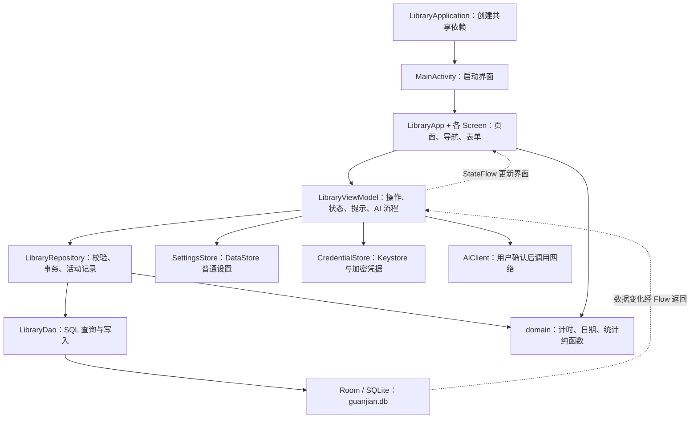

# 馆间《完成.md》：项目架构、场景树与小白修改指南

> 编写日期：2026-09-11。本文根据当前项目里的实际代码、构建配置和已有测试报告编写。
>
> **文件叫“完成.md”，不代表原始需求已经全部验收完成。** 当前已有核心功能代码、Debug APK 和单元测试通过报告；手机上的完整交互、进程恢复与真实 Keystore 等验收仍需继续核实。第 12 节列出具体状态。
>
> 项目根目录：`D:\文档\ChatGPT\图书记录工具`。应用名称：**馆间**；代码包名：`com.guanjian.app`。

## 1. 从哪里开始读

如果你刚接触 Android，可以按这个顺序：

1. **只想知道应用能做什么**：先看第 3 节“场景树”。
2. **想改文字、颜色、按钮**：看第 8 节“功能修改速查表”和第 9 节的例子。
3. **想理解点击保存之后发生什么**：看第 5 节“数据流”。
4. **想给书籍或卡片增加字段**：先看第 6 节，再看第 9.5 节。
5. **想编译和安装**：看第 11 节。
6. **想知道哪些已经验证**：看第 12 节。

初学时不用从头读完所有 Kotlin 文件。先确定“我要改变哪个行为”，再沿着文档找到对应文件。

## 2. 项目是什么架构

### 2.1 一句话理解

**页面负责显示和接收输入；ViewModel 负责状态与操作协调；Repository 负责业务规则；Room 负责把记录保存到手机。**

另外有三条独立的数据通道：

- 普通设置通过 **DataStore** 保存。
- API Key 通过 **Android Keystore + 加密文件** 保存。
- 只有用户确认 AI 操作后，才通过 **Retrofit** 发起网络请求。

这里的“本地优先”是指：记书、写卡片、计划、计时、统计都不需要服务器。AI 请求是额外功能。

### 2.2 先认识几个名字

| 名字 | 用普通话解释 | 本项目中的例子 |
|---|---|---|
| Kotlin | 写应用逻辑的语言 | 所有 `.kt` 文件 |
| Compose | 用 Kotlin 函数描述界面的方式 | `Text(...)` 显示文字，`Button(...)` 显示按钮 |
| Material 3 | 现成的按钮、输入框、颜色等组件规范 | 页面中的卡片、底栏、对话框 |
| Activity | Android 的一个界面承载入口 | 本项目只有 `MainActivity` |
| Composable | 一个可以画界面的函数 | `BooksScreen()`、`BookEditor()` |
| Navigation | 决定点按钮后去哪个页面 | `nav.navigate("books")` |
| ViewModel | 页面状态和操作的协调者 | `LibraryViewModel` |
| Repository | 集中处理保存、校验、联动的业务入口 | `LibraryRepository.saveBook()` |
| Entity | 一类数据库记录的结构 | 一本书对应一个 `BookEntity` |
| DAO | 读取和写入数据库的方法集合 | `LibraryDao.books()`、`putBook()` |
| Room | 帮 Kotlin 代码操作 SQLite 数据库的工具 | `LibraryDatabase` |
| Flow / StateFlow | 数据改变时，持续通知观察者 | 书籍保存后，书墙收到新列表 |
| Coroutine / suspend | 让耗时工作不堵住界面的机制 | 保存数据库、请求 AI |
| Gradle | 下载依赖、编译代码、运行测试、打包 APK 的工具 | `gradlew.bat` |
| APK | 可以安装到 Android 手机上的应用包 | `app-debug.apk` |

`MVVM` 是 Model、View、ViewModel 的缩写。你可以把它理解为“数据、界面、状态协调”分工。本项目没有再增加复杂的模块或依赖注入框架。

### 2.3 实际架构图



如果编辑器没有显示图形，仍可按上面各行中的箭头理解调用方向。

**当前实现的几个具体选择：**

- 只有一个 `app` 模块，不是多个 Android 子项目。
- 四个主页面共享一个 `LibraryViewModel`。
- 书籍、卡片、计划和专注共用一个 `LibraryRepository`。
- `LibraryApp.kt` 中会用 `vm.act { vm.repo.saveBook(...) }` 连接页面与业务操作；没有为每个按钮单独建立 ViewModel 方法。
- `domain` 目录里的计算不依赖界面，方便单独测试。
- `ui` 里的部分页面会直接使用领域计算结果，例如周统计与阅读进度。
- `AiClient` 只处理 AI；`BookMetadataClient` 只读取豆瓣读书公开网页中的出版信息。两者都不负责同步本地书籍数据库。

## 3. 场景树：用户从哪里进入，能做哪些事

“场景树”指的是用户操作的分支，不是文件夹结构。

### 3.1 完整页面与操作树

```text
打开馆间
├─ 今天（默认首页）
│  ├─ 看日期、本周活跃天数、专注分钟、卡片数量
│  ├─ 今日小计划
│  │  ├─ 新建计划
│  │  │  ├─ 找一本书
│  │  │  ├─ 阅读一定页数
│  │  │  ├─ 自习一定分钟
│  │  │  ├─ 写一张卡片
│  │  │  └─ 自定义任务
│  │  ├─ 勾选完成 / 改回未完成
│  │  └─ 删除子任务 → 二次确认（已有历史记录保留）
│  ├─ 开始专注 / 回到已有专注
│  │  ├─ 选择活动，可选关联书籍
│  │  ├─ 开始 → 暂停 → 继续
│  │  └─ 结束专注 → 立即保存时间 → 一次性打开记录卡片
│  │     ├─ 保存卡片 → 留下想法
│  │     └─ 直接返回 → 放弃卡片，专注时间仍已保存
│  ├─ 快速记卡片
│  └─ 看今天自动产生的活动记录
│
├─ 书墙
│  ├─ 记一本书
│  │  ├─ 书名、大概位置、阅读状态
│  │  ├─ 搜索书籍信息（ISBN 精确搜索 / 书名模糊搜索）
│  │  │  └─ 进入候选子页面 → 选择结果 → 下载封面 → 填回编辑页
│  │  └─ 展开更多：作者、ISBN、出版社、出版时间、简介、页码、结构化位置、备注、封面
│  ├─ 看书籍网格
│  │  └─ 封面颜色随阅读进度变化，读完显示标记
│  └─ 打开某本书的详情
│     ├─ 直接输入并保存当前已读页数（只改进度）
│     ├─ 编辑书籍 / 位置 / 状态等完整资料
│     ├─ 开始阅读这本书
│     │  └─ 若另一任务正在计时 → 询问是否保存旧计时并切换
│     ├─ 为这本书创建卡片（自动关联）
│     ├─ 看关联卡片 / 打开卡片编辑
│     └─ 删除书籍 → 二次确认
│
├─ 卡片
│  ├─ 新建卡片
│  │  ├─ 正文必填，标题可留空
│  │  ├─ 可展开写作提示
│  │  └─ 可选书籍、标签
│  ├─ 搜索正文
│  ├─ 按书籍筛选 → 底部选择页搜索书名、滚动选择、一键清除
│  ├─ 按标签筛选 → 底部选择页搜索标签、滚动选择、一键清除
│  └─ 打开已有卡片
│     ├─ 编辑并保存
│     ├─ AI 整理（先保存当前编辑内容）
│     │  └─ 确认发送 → 请求 → 预览 → 保存替换正文
│     └─ 删除卡片 → 二次确认
│
├─ 回顾
│  ├─ 上一周 / 下一周 / 回到本周
│  ├─ 看目标与进度
│  │  └─ 编辑学习次数、专注分钟、阅读页数、卡片数量
│  ├─ 看本地规则生成的统计摘要
│  ├─ 打开“月度学习足迹”子页面（GitHub 风格热力图）
│  │  ├─ 上个月 / 下个月
│  │  ├─ 颜色深浅综合学习时间、阅读书籍和完成计划
│  │  └─ 点击日期方格 → 看当天分钟、书籍/页数、计划明细
│  ├─ 打开“AI 回顾”子页面
│  │  ├─ 生成 AI 周回顾
│  │  └─ 确认发送 → 请求 → 预览 → 保存周回顾
│  │  ├─ 看已保存的 AI 周回顾
│  │  ├─ 寻找下一步探索方向
│  │  │  └─ 确认发送 → 请求 → 预览 → 保存为探索卡片
│  │  └─ AI 设置
│     ├─ OpenAI / DeepSeek / OpenAI 兼容接口
│     ├─ API Key（保存后仅显示掩码）
│     ├─ 模型名称与 Base URL
│     ├─ 保存、测试连接
│     └─ 删除凭据 → 二次确认
```

底栏只在四个主页面显示。进入书籍详情、表单、专注或 AI 设置后，顶部提供返回按钮。顶栏右上角不再显示设置齿轮；应用外观自动跟随手机系统，不提供单独的主题开关。

书籍与标签选择器不再使用又长又窄的悬浮下拉菜单。点击后会打开高度约为屏幕 80% 的底部选择页：顶部输入关键字，下方滚动浏览结果，当前项会显示标记。这套组件同时用在卡片筛选、卡片关联书籍和专注关联书籍。

**AI 是一个没有底栏的子页面。** 点击 AI 功能后会进入 `ai` 路由，顶部返回箭头、系统返回键和页面底部“返回”都会关闭本次 AI 状态。确认、加载、预览或错误仍由同一个状态流程切换，但不会再以弹窗覆盖原页面。

**书籍刮削也是没有底栏的子页面。** 它使用 `book-lookup` 路由。打开页面不会联网，只有点击“搜索”才把输入框中的 ISBN 或书名发给豆瓣读书。选择候选后会把封面转换成真正的本地 JPEG，只填回编辑表单；仍需点击“保存书籍”才会写入 Room。

### 3.2 场景一：记录一本书并开始阅读

```text
书墙 → 记一本书 → 输入书名和位置 → 保存
     → 书墙出现这本书 → 打开详情
     → 编辑状态为“已找到” → 保存
     → 开始阅读这本书 → 现在开始
     → 结束专注 → 专注时间和活动记录立即保存
     → 自动打开“记录这一刻” → 可保存卡片，也可直接返回
```

主要代码路线：

`BooksScreen → BookEditor → LibraryApp 中的 onSave → vm.act → repo.saveBook`

书籍信息刮削路线：

`BookEditor → book-lookup → LibraryViewModel.searchBookMetadata → BookMetadataClient → 选择候选 → 本地保存封面 → mergeBookMetadata → 回到 BookEditor`

默认只填空白出版字段。打开“覆盖已填写的出版信息”后，可以替换书名、作者、ISBN、出版社、出版时间、简介、总页数和封面；图书馆位置、阅读状态、当前页、个人备注、ID 和时间始终保留。

阅读结束则走：

`FocusScreen → repo.finishFocus → sessions / events → card/new（一次性）`

### 3.3 场景二：带着计划开始自习

```text
今天 → 添加小计划 → 选择“自习一定分钟” → 保存
     → 开始专注 → 现在开始
     → 暂停或切到后台 → 回来继续
     → 结束专注 → 时间立即保存 → 自动打开记录卡片
     → 保存卡片或直接返回 → 今天的活动记录和本周统计更新
```

**计划不会只因计时达到 25 分钟就自动完成。** 当前需要用户在今天页面手动勾选完成。

### 3.4 场景三：从书籍详情留下想法

```text
书籍详情 → 为这本书写卡片
         → 页面自动带入 bookId
         → 输入正文 → 保存
         → 书籍详情出现关联卡片
         → 卡片主页面也能看到它
```

两处显示的是同一条卡片记录，不是复制了两份内容。

### 3.5 场景四：选择使用 AI

```text
回顾 → AI 设置 → 选服务、填地址、模型、Key → 保存
     → 测试连接 → 进入 AI 子页面 → 检查本次发送说明 → 确认并发送
回顾 → 生成 AI 周回顾
     → 进入 AI 子页面 → 检查服务地址、摘要、完整待发内容
     → 确认并发送 → 等待结果
     ├─ 关闭：不写入回顾数据库
     └─ 保存周回顾：写入本地
```

没有 Key 时，本地回顾照常显示；AI 请求会给出配置提示。测试连接也可能消耗服务额度，因为它会发送一条很短的模型请求。

## 4. 文件树：代码放在哪里

下面是主要文件。为方便阅读，树中用项目内名称；第 8 节提供可点击的完整路径。

```text
图书记录工具/
├─ 完成.md                        ← 这份入门说明
├─ 项目说明.md                    ← 现有的较详细技术说明
├─ 提示词.md                      ← 现有文档，非应用运行代码
├─ settings.gradle.kts            ← 仓库地址、项目名、包含 app 模块
├─ build.gradle.kts               ← Android / Kotlin / KSP 插件版本
├─ gradle.properties              ← 构建内存、编码、AndroidX 等
├─ gradlew / gradlew.bat           ← Gradle 启动入口
├─ gradle/wrapper/                ← Wrapper 配置及启动 JAR
├─ local.properties               ← 本机 SDK 路径，不应提交
├─ scripts/
│  ├─ build-apk.ps1               ← 本机中文路径构建辅助脚本
│  ├─ build.ps1                   ← 指定英文路径和 JDK 的构建脚本
│  └─ test-domain.ps1             ← 使用本地工具运行纯领域测试
├─ docs/superpowers/
│  ├─ specs/                     ← 已确认设计
│  └─ plans/                     ← 分阶段实施计划
├─ app/
│  ├─ build.gradle.kts            ← app 依赖、SDK 版本、测试配置
│  ├─ schemas/                   ← Room 导出的数据库结构版本
│  ├─ src/main/
│  │  ├─ AndroidManifest.xml      ← 应用声明、入口、网络权限
│  │  ├─ res/values/themes.xml    ← Android 窗口基础主题
│  │  └─ java/com/guanjian/app/
│  │     ├─ LibraryApplication.kt
│  │     ├─ MainActivity.kt
│  │     ├─ ui/
│  │     │  ├─ LibraryApp.kt       ← 顶栏、底栏、所有页面跳转
│  │     │  ├─ NavigationMotion.kt  ← 页面切换动画时长
│  │     │  ├─ LibraryViewModel.kt ← 状态、保存协调、AI 操作
│  │     │  ├─ TodayScreen.kt      ← 今天 + 计划编辑
│  │     │  ├─ BooksScreen.kt      ← 书墙 + 封面 + 详情 + 编辑
│  │     │  ├─ BookLookupScreen.kt ← ISBN / 书名搜索和候选子页面
│  │     │  ├─ BookMetadataMerge.kt ← 安全地把候选填入本地编辑草稿
│  │     │  ├─ CardsScreen.kt      ← 卡片列表 + 编辑
│  │     │  ├─ FocusScreen.kt      ← 活动选择 + 计时 + 结束按钮
│  │     │  ├─ ReviewScreen.kt     ← 周回顾 + 周目标编辑
│  │     │  ├─ SettingsScreen.kt   ← 外观和 AI 设置
│  │     │  ├─ AiScreen.kt         ← AI 确认 / 加载 / 预览子页面
│  │     │  ├─ AiPayload.kt        ← 本地摘要、提示词共用规则、返回清理、预览裁切
│  │     │  ├─ Components.kt       ← 通用表单、卡片区块、删除确认
│  │     │  └─ theme/Theme.kt      ← Compose 浅色和深色
│  │     ├─ domain/
│  │     │  ├─ ReadingRules.kt     ← 阅读百分比、周起点、有效记录类型
│  │     │  ├─ FocusClock.kt       ← 专注时间与暂停恢复计算
│  │     │  └─ WeeklyStats.kt      ← 周统计、跨日时间拆分
│  │     ├─ data/
│  │     │  ├─ Entities.kt        ← 所有数据表结构与关系对象
│  │     │  ├─ LibraryDao.kt      ← 数据库查询和写入
│  │     │  ├─ LibraryDatabase.kt ← Room 数据库创建
│  │     │  ├─ LibraryRepository.kt ← 业务规则和事务
│  │     │  └─ SettingsStore.kt   ← DataStore 普通设置
│  │     ├─ ai/AiClient.kt         ← 网络协议、配置校验、中文错误
│  │     ├─ books/BookMetadataClient.kt ← 豆瓣读书搜索、详情解析、封面下载
│  │     └─ security/CredentialStore.kt ← Key 加密读写
│  ├─ src/test/                   ← 电脑上运行的单元 / Robolectric 测试
│  ├─ src/androidTest/            ← 需要 Android 设备的测试
│  └─ build/                      ← 自动生成的 APK、编译产物、报告
└─ .tools/                        ← 本机下载的 SDK、Gradle、缓存等，Git 忽略
```

**通常改 `app/src/main`。不要直接修改 `app/build` 里的生成代码来修功能。** 重新编译后，生成目录里的修改会被覆盖。

`app/schemas` 是数据库结构历史，需要保留；它和可以随时重建的 `app/build` 不一样。

## 5. 点击“保存”之后，数据怎么走

### 5.1 用“保存书籍”举例

1. `BookEditor` 收集书名、作者、位置等输入。
2. 页面先检查书名是否为空、页码是否合法。
3. 页面把输入组装成 `BookEntity`，调用 `onSave(book)`。
4. `LibraryApp` 接住这个回调，执行 `vm.act { vm.repo.saveBook(book) }`。
5. `act` 设置 `busy = true`，避免重复操作，并负责成功或失败提示。
6. `saveBook` 再做业务校验，判断数据库里是否已经有这个 ID。
7. Repository 在事务中调用 DAO，保存书籍并按需生成活动事件。
8. Room 通知观察书籍列表的 Flow。
9. ViewModel 收到新列表，更新 `LibraryUiState.books`。
10. Compose 观察到状态变化，书墙自动刷新；成功后编辑页面返回。

所以：

- **界面没显示输入框**：看页面文件。
- **保存时提示不正确**：看页面校验、`act`、Repository 校验。
- **保存后周统计不变**：看有没有写 `events`，不能只看书籍是否保存。
- **排序不符合预期**：先看 DAO 的 `ORDER BY`。

### 5.2 为什么页面和 Repository 都校验

页面校验让用户马上看到问题；Repository 校验保证其他调用入口也遵守规则。

例如，将来你增加批量导入，它可能绕过 `BookEditor`。如果“书名不能为空”只写在页面，导入就可能把空白书名存进数据库。

### 5.3 状态分成四种，不要混淆

| 状态位置 | 适合保存什么 | 不能当作什么 |
|---|---|---|
| 页面 `remember` | 展开菜单、短暂显示状态、Key 输入 | 长期数据存储 |
| 页面 `rememberSaveable` | 搜索词、表单草稿、当前查看周次 | 数据库或任意退出后的永久草稿 |
| ViewModel / StateFlow | 当前页面数据、busy、AI 预览 | 进程被终止后仍然存在的存储 |
| Room / DataStore / 加密文件 | 已保存业务数据、普通设置、凭据 | 同一种用途的混合存储 |

ViewModel 通常能跨屏幕旋转保留，但进程被系统结束后会重新创建。**计时可靠性来自 Room 保存的时间状态，不是因为 ViewModel 永远存在。**

AI 结果在点击保存前保存在内存中；当前不是持久化草稿，进程退出后可能丢失预览。

## 6. 数据模型：每张表负责什么

### 6.1 业务数据在 Room 中

数据库名称为 `guanjian.db`，当前结构版本为 `2`，创建入口是 [LibraryDatabase.kt](D:/文档/ChatGPT/图书记录工具/app/src/main/java/com/guanjian/app/data/LibraryDatabase.kt)。版本 1 升到版本 2 时，`MIGRATION_1_2` 只增加四个空白出版信息字段，不会删除或重建旧表。

| Entity / 表名 | 一条记录代表什么 | 主要字段 |
|---|---|---|
| `BookEntity / books` | 一本书 | title、author、isbn、publisher、publishedDate、description、五项位置、status、currentPage、totalPages、coverUri、note、时间 |
| `NoteCardEntity / cards` | 一张卡片 | title、content、bookId、时间 |
| `TagEntity / tags` | 一个可复用标签 | id、name |
| `NoteTagCrossRef / note_tags` | 某卡片拥有某标签 | noteId、tagId |
| `DailyPlanEntity / plans` | 一项某日计划 | date、type、title、targetValue、unit、完成状态和时间 |
| `FocusSessionEntity / sessions` | 一次已经保存的专注 | activityType、bookId、开始结束时间、时长、页码、感受 |
| `WeeklyGoalEntity / goals` | 某一周的目标 | weekStartDate、四项目标值 |
| `WeeklyReviewEntity / reviews` | 某一周已保存的回顾 | weekStartDate、localSummary、aiSummary |
| `ActivityEventEntity / events` | 一次用于记录和统计的活动 | date、type、sourceId、title、pages、focusMillis |
| `ActiveFocusEntity / active_focus` | 当前尚未完成保存的专注 | 固定行 singleton、activityType、bookId、clock、awaitingSummary |
| `FocusSegmentEntity / focus_segments` | 某次专注的一段按日拆分时间 | focusId、date、durationMillis |

`NoteWithTags` **不是数据库表**，而是读取时把“卡片 + 标签列表”放在一起的对象。Room 的关系读取可能包含多条查询，因此 DAO 用事务保证一致性。

### 6.2 表之间的关系

```text
一本书 books
├─ 可以关联多张 cards
├─ 可以关联多次已完成 sessions
└─ 可以关联当前 active_focus

一张 cards
└─ 通过 note_tags 关联多个 tags
   同一个 tags 也可以被多张 cards 使用

一次 active_focus
└─ 暂停 / 结束时产生 focus_segments
   点击“结束专注”后立即产生 sessions 与 events，并清除 active_focus

events
└─ 为今天活动列表、有效记录日、本周统计提供历史依据
```

删除书籍时，相关卡片和专注记录保留，`bookId` 变为空。删除卡片时，该卡片的标签关联会被清理。

活动事件的 `sourceId` 刻意没有外键：删掉一本书，不会把过去已经发生的学习记录也删掉。这里的“删除内容”和“抹掉学习历史”是不同操作。

### 6.3 时间与 ID

- ID 使用 UUID 字符串，例如一段由字母、数字和连字符组成的唯一编号。
- 绝对时间使用 `Long`，单位为 UTC 毫秒。
- 日历日期使用 `String`，格式为 `2026-09-11`。
- 周目标的日期保存为该周周一。
- 当前采用 `Long / String` 直接入库，并在需要时通过 `Instant / LocalDate` 转换；没有单独的 Room `TypeConverter` 文件。

修改时注意 `durationMillis` 与 `durationMinutes` 的单位，不能把毫秒当分钟显示。

### 6.4 普通设置和凭据不混入业务表

| 数据 | 保存位置 | 管理文件 |
|---|---|---|
| 主题、服务类型、Base URL、模型 | DataStore Preferences | [SettingsStore.kt](D:/文档/ChatGPT/图书记录工具/app/src/main/java/com/guanjian/app/data/SettingsStore.kt) |
| 用户 API Key 密文 | 应用的 noBackupFilesDir 中 `ai-credential.enc` | [CredentialStore.kt](D:/文档/ChatGPT/图书记录工具/app/src/main/java/com/guanjian/app/security/CredentialStore.kt) |
| 保护密文的 AES 密钥 | Android Keystore | 同上 |
| 已导入书籍封面 | 应用私有 `filesDir/covers` 目录 | [LibraryApp.kt](D:/文档/ChatGPT/图书记录工具/app/src/main/java/com/guanjian/app/ui/LibraryApp.kt) |

这些是**安装后的手机应用目录**，不是你电脑项目根目录里的同名文件夹。源码和用户手机里的数据是两回事。

## 7. 重要业务规则：改功能前先理解这些

### 7.1 阅读进度和封面

`readingProgress(current, total, completed)` 在 [ReadingRules.kt](D:/文档/ChatGPT/图书记录工具/app/src/main/java/com/guanjian/app/domain/ReadingRules.kt)：

- 标记读完：返回 100%。
- 没有总页数或总页数不合法：返回 0%。
- 有总页数：当前页 ÷ 总页数，并限制在 0% 到 100%。

`BookCover` 使用这个比例控制颜色。有图片时调饱和度，没有图片时根据书名生成占位封面。

**封面进度不等于本周阅读页数。** 前者看书的当前位置；后者累计活动事件里的页数增量。

### 7.2 自动记录与每周统计

以下事件算有效记录：

| 事件类型 | 产生时机 |
|---|---|
| `BOOK_ADDED` | 新增书籍 |
| `PROGRESS` | 阅读页码发生变化 |
| `CARD_ADDED` | 新增卡片 |
| `PLAN_COMPLETED` | 计划从未完成变为完成 |
| `FOCUS_COMPLETED` | 完成并保存专注 |

当前统计规则：

- 同一天有多个有效活动，也只算一个活跃日。
- “到馆或学习次数”采用活跃日口径，不是真实 GPS 到馆次数，也不是专注次数。
- 专注先累计毫秒，再统一换算分钟，避免每次小于一分钟的活动都被提前丢弃。
- 修改卡片正文不再算一张“新增卡片”。
- 修改书名不会算一次阅读进度。
- 页码向后校正仍留下有效记录，但本次阅读页数为 0。
- 撤销计划完成时，会撤销对应的完成事件。
- 删除源书籍、卡片不会自动清空历史活动统计。

规则分布在 [LibraryRepository.kt](D:/文档/ChatGPT/图书记录工具/app/src/main/java/com/guanjian/app/data/LibraryRepository.kt)、[ReadingRules.kt](D:/文档/ChatGPT/图书记录工具/app/src/main/java/com/guanjian/app/domain/ReadingRules.kt) 和 [WeeklyStats.kt](D:/文档/ChatGPT/图书记录工具/app/src/main/java/com/guanjian/app/domain/WeeklyStats.kt)，不要只改页面上的数字。

### 7.3 计时器实际是状态机

```text
没有活动专注
  └─ startFocus → 正在计时
                    ├─ pauseFocus → 已暂停
                    │                 └─ resumeFocus → 正在计时
                    └─ finishFocus → 保存流水、清除活动专注
                                      └─ 一次性打开新建卡片，可保存或放弃
```

`prepareFinish` 仍保留在仓库层，用于兼容旧版本可能留下的“等待总结”记录，但当前正常界面流程不再调用它。

`FocusScreen` 每秒刷新的是显示，不是每秒往数据库加一秒。

真实计算在 `FocusClock`：

- 同一次设备启动期间，使用 `elapsedRealtime` 这类单调时钟。
- 系统日期时间被手动调整，不应直接改变该次计时的累计秒数。
- 检测到设备重启时，使用已保存的墙上时间作为恢复依据，并提示核对。
- 暂停时，把这一运行片段结算进累计时长。
- 再次恢复时，开始新的运行片段。
- 跨午夜的片段按本地日期拆分，跨周时也能分别统计。

`finishFocus` 使用数据库事务处理结束动作。同一专注 ID 已经保存过时，不重复保存，以防重复点击让时长翻倍。

### 7.4 AI 提示词、发送内容和返回清理

- **周回顾与本地摘要**：在 [AiPayload.kt](D:/文档/ChatGPT/图书记录工具/app/src/main/java/com/guanjian/app/ui/AiPayload.kt)。
- **卡片整理、探索建议、连接测试**：在 [LibraryViewModel.kt](D:/文档/ChatGPT/图书记录工具/app/src/main/java/com/guanjian/app/ui/LibraryViewModel.kt) 的 `proposeAi`。
- **网络请求的协议与消息封装**：在 [AiClient.kt](D:/文档/ChatGPT/图书记录工具/app/src/main/java/com/guanjian/app/ai/AiClient.kt)。当前把已构造的提示词作为一条 user 消息发送，没有额外的 system 消息。
- **所有用途共用的输出要求**：在 `AiPayload.kt` 的 `aiOutputRules`。它要求自然中文、限制内部字段，并把卡片内容标记为只读参考资料。
- **AI 返回内容的保护清理**：在 `AiPayload.kt` 的 `sanitizeAiOutput`。即使服务意外返回 UUID、`bookId` 或 `cardId` 等字段，也会在预览和保存前删除；日期、页码、ISBN 会保留。

内部 ID 仍然存在于 Room 数据库中，也仍用于本地关联书籍、卡片、活动和专注记录。这里修改的是**发给 AI 的文本**：提示词只使用日期、标题、书名和事实，不再拼接数据库 UUID。不要为了让 AI “方便引用”而重新把 `id`、`bookId`、`sourceId` 等字段加入 payload。

AI 状态为：

```text
proposeAi：构造数据 → CONFIRM（尚未联网）
confirmAi：确认后 → LOADING
                         ├─ 成功 → PREVIEW（尚未写库）
                         │           └─ saveAi → 写库
                         └─ 失败 → ERROR（中文提示）

cancelAi：取消请求 / 离开 AI 子页面 / 清空临时状态
```

当前 AI 保存行为：

| 类型 | 保存到哪里 |
|---|---|
| 整理卡片 | 替换原卡片正文，保留关联和标签；保存前检查原卡片是否被修改 |
| 周回顾 | `WeeklyReviewEntity.aiSummary` |
| 探索建议 | 新建“下一步探索”卡片，并加“探索”标签 |
| 测试连接 | 不写入业务数据库 |

当前 AI 预览文字可查看、选择，但没有预览内编辑框。该点与设计中的“整理卡片保留编辑机会”仍有差距，详见第 12 节。

AI 保存后的卡片正文仍完整保存在数据库中。卡片主列表和书籍详情中的关联卡片只调用 `cardPreview` 展示最多 160 字，再用 Compose 限制为 3 行并显示省略号。想改变卡片的“看起来多高”，改预览长度或 `maxLines`；不要在 `saveAi` 中截断正文，否则打开卡片后也会永久丢失后半段。

### 7.5 API Key 的边界

Key 不在源码、Room 或普通 DataStore 中。保存时加密，已保存状态在 UI 中只显示固定掩码；发请求时网络层仍需要短暂使用明文凭据，因此不能宣称绝对安全。

设置页面设置 `FLAG_SECURE`，Key 输入不使用 `rememberSaveable`，避免进入保存的界面状态。不要为了方便调试而打印 Key、Authorization 或完整请求体。

`AiProvider` 当前主要是服务类型选择和配置记录；OpenAI、DeepSeek 和兼容接口都走 Chat Completions 兼容协议，没有独立的多供应商适配框架。

## 8. 功能管理：想改什么，就从哪里开始

目前没有单独的“管理员后台”或远程功能开关。这里的功能管理主要是**通过代码修改页面、业务规则和设置**。

| 想修改的内容 | 先打开 | 搜索的名字 | 可能还需要改 |
|---|---|---|---|
| 应用安装后的名称 | [AndroidManifest.xml](D:/文档/ChatGPT/图书记录工具/app/src/main/AndroidManifest.xml) | `android:label` | 页面顶栏里的“馆间”是另一个位置 |
| App 桌面图标 | [AndroidManifest.xml](D:/文档/ChatGPT/图书记录工具/app/src/main/AndroidManifest.xml) | `android:icon`、`android:roundIcon` | 书本图形在 `res/drawable/ic_launcher_foreground.xml`，背景色在 `res/values/colors.xml`，自适应组合在 `res/mipmap-anydpi-v26/` |
| 顶栏、底栏文字和跳转 | [LibraryApp.kt](D:/文档/ChatGPT/图书记录工具/app/src/main/java/com/guanjian/app/ui/LibraryApp.kt) | `tabs`、`NavHost`、`composable` | 新页面自身 |
| 页面切换动画快慢 | [NavigationMotion.kt](D:/文档/ChatGPT/图书记录工具/app/src/main/java/com/guanjian/app/ui/NavigationMotion.kt) | `durationMillis` | `LibraryApp.kt` 将它用于进出和返回动画 |
| 今天首页文字、布局 | [TodayScreen.kt](D:/文档/ChatGPT/图书记录工具/app/src/main/java/com/guanjian/app/ui/TodayScreen.kt) | `TodayScreen` | 通用组件 |
| 计划模板、默认 25 分钟 | [TodayScreen.kt](D:/文档/ChatGPT/图书记录工具/app/src/main/java/com/guanjian/app/ui/TodayScreen.kt) | `PlanEditor`、`templates` | 保存校验若有变化则改 Repository |
| 书墙列宽、间距 | [BooksScreen.kt](D:/文档/ChatGPT/图书记录工具/app/src/main/java/com/guanjian/app/ui/BooksScreen.kt) | `GridCells.Adaptive` | 通常不用改数据库 |
| 封面大小、颜色、完成标记 | [BooksScreen.kt](D:/文档/ChatGPT/图书记录工具/app/src/main/java/com/guanjian/app/ui/BooksScreen.kt) | `BookCover` | 阅读规则在 ReadingRules |
| 书名、位置等输入表单 | [BooksScreen.kt](D:/文档/ChatGPT/图书记录工具/app/src/main/java/com/guanjian/app/ui/BooksScreen.kt) | `BookEditor` | Entities、Repository |
| 详情页快速修改已读页数 | [BooksScreen.kt](D:/文档/ChatGPT/图书记录工具/app/src/main/java/com/guanjian/app/ui/BooksScreen.kt) | `BookDetailScreen`、`quickProgressBook` | `LibraryApp` 调用 `repo.saveBook`，`BookQuickProgressTest` 保证其他字段不变 |
| 书籍 ISBN / 书名搜索界面 | [BookLookupScreen.kt](D:/文档/ChatGPT/图书记录工具/app/src/main/java/com/guanjian/app/ui/BookLookupScreen.kt) | `BookLookupScreen`、`BookLookupUiState` | 路由在 LibraryApp，状态在 ViewModel |
| 书籍搜索请求与字段映射 | [BookMetadataClient.kt](D:/文档/ChatGPT/图书记录工具/app/src/main/java/com/guanjian/app/books/BookMetadataClient.kt) | `search`、`loadDetail`、`downloadCover` | `BookMetadataClientTest` |
| 刮削字段覆盖规则 | [BookMetadataMerge.kt](D:/文档/ChatGPT/图书记录工具/app/src/main/java/com/guanjian/app/ui/BookMetadataMerge.kt) | `mergeBookMetadata` | `BookMetadataMergeTest` |
| 阅读状态选项 | [BooksScreen.kt](D:/文档/ChatGPT/图书记录工具/app/src/main/java/com/guanjian/app/ui/BooksScreen.kt) | `bookStatuses` | Repository 中“在读 / 读完”的判断 |
| 卡片列表、搜索与筛选 | [CardsScreen.kt](D:/文档/ChatGPT/图书记录工具/app/src/main/java/com/guanjian/app/ui/CardsScreen.kt) | `CardsScreen`、`filtered` | 当前筛选在内存里完成 |
| 月度学习热力图 | [MonthlyActivityHeatmap.kt](D:/文档/ChatGPT/图书记录工具/app/src/main/java/com/guanjian/app/ui/MonthlyActivityHeatmap.kt) | `MonthlyActivityHeatmap`、`activityColor` | 汇总和 0–4 级规则在 `domain/MonthlyActivity.kt` |
| 卡片列表预览长度 | [AiPayload.kt](D:/文档/ChatGPT/图书记录工具/app/src/main/java/com/guanjian/app/ui/AiPayload.kt) | `cardPreview`、`limit` | `CardsScreen.kt` 和 `BooksScreen.kt` 的 `maxLines` |
| 卡片输入、写作提示 | [CardsScreen.kt](D:/文档/ChatGPT/图书记录工具/app/src/main/java/com/guanjian/app/ui/CardsScreen.kt) | `CardEditor`、`prompts` | 必填校验还在 Repository |
| 自动生成卡片标题的长度 | [LibraryRepository.kt](D:/文档/ChatGPT/图书记录工具/app/src/main/java/com/guanjian/app/data/LibraryRepository.kt) | `take(24)` | 列表展示可另行调整 |
| 专注活动种类、计时与结束按钮 | [FocusScreen.kt](D:/文档/ChatGPT/图书记录工具/app/src/main/java/com/guanjian/app/ui/FocusScreen.kt) | `activityTypes`、`FocusScreen` | 结束后的导航在 LibraryApp |
| 暂停、恢复、重启计时规则 | [FocusClock.kt](D:/文档/ChatGPT/图书记录工具/app/src/main/java/com/guanjian/app/domain/FocusClock.kt) | `duration`、`pause`、`resume` | Repository 与 FocusClockTest |
| 专注结束后的保存与一次性卡片 | [LibraryApp.kt](D:/文档/ChatGPT/图书记录工具/app/src/main/java/com/guanjian/app/ui/LibraryApp.kt) | `onEnd`、`cardRoute` | 数据保存由 Repository 的 `finishFocus` 完成 |
| 什么行为算有效记录 | [ReadingRules.kt](D:/文档/ChatGPT/图书记录工具/app/src/main/java/com/guanjian/app/domain/ReadingRules.kt) | `isEffectiveRecord` | Repository 事件创建位置 |
| 周统计怎么算 | [WeeklyStats.kt](D:/文档/ChatGPT/图书记录工具/app/src/main/java/com/guanjian/app/domain/WeeklyStats.kt) | `weeklyStats`、`splitInterval` | 对应单元测试 |
| 默认周目标 | [Entities.kt](D:/文档/ChatGPT/图书记录工具/app/src/main/java/com/guanjian/app/data/Entities.kt) | `WeeklyGoalEntity` | 旧的已保存目标不会自动改变 |
| 回顾页进度条和目标表单 | [ReviewScreen.kt](D:/文档/ChatGPT/图书记录工具/app/src/main/java/com/guanjian/app/ui/ReviewScreen.kt) | `ReviewScreen`、`GoalEditor` | WeeklyStats |
| 本地回顾的文字 | [AiPayload.kt](D:/文档/ChatGPT/图书记录工具/app/src/main/java/com/guanjian/app/ui/AiPayload.kt) | `localSummary` | 不必改网络客户端 |
| AI 周回顾发送哪些记录 | [AiPayload.kt](D:/文档/ChatGPT/图书记录工具/app/src/main/java/com/guanjian/app/ui/AiPayload.kt) | `reviewPayload` | 发送确认摘要必须同步更新，不能加入内部 ID |
| AI 卡片整理、探索提示词 | [LibraryViewModel.kt](D:/文档/ChatGPT/图书记录工具/app/src/main/java/com/guanjian/app/ui/LibraryViewModel.kt) | `proposeAi` | AI 相关测试 |
| AI 通用输出规则、返回 ID 清理 | [AiPayload.kt](D:/文档/ChatGPT/图书记录工具/app/src/main/java/com/guanjian/app/ui/AiPayload.kt) | `aiOutputRules`、`sanitizeAiOutput` | `AiPayloadTest`、`LibraryViewModelTest` |
| AI 确认、加载、预览样式 | [AiScreen.kt](D:/文档/ChatGPT/图书记录工具/app/src/main/java/com/guanjian/app/ui/AiScreen.kt) | `AiScreen`、`AiPhase` | `LibraryApp.kt` 中的 `ai` 路由 |
| 默认模型与 Base URL | [SettingsStore.kt](D:/文档/ChatGPT/图书记录工具/app/src/main/java/com/guanjian/app/data/SettingsStore.kt) | `AppSettings` | AiConfig 默认值与设置页 OpenAI 切换地址 |
| 网络超时、错误提示 | [AiClient.kt](D:/文档/ChatGPT/图书记录工具/app/src/main/java/com/guanjian/app/ai/AiClient.kt) | `timeoutMillis`、`AiError` | AiClientTest |
| Key 加密和删除 | [CredentialStore.kt](D:/文档/ChatGPT/图书记录工具/app/src/main/java/com/guanjian/app/security/CredentialStore.kt) | `AndroidCredentialStore` | Keystore 设备测试 |
| 深浅色主色 | [Theme.kt](D:/文档/ChatGPT/图书记录工具/app/src/main/java/com/guanjian/app/ui/theme/Theme.kt) | `LightColors`、`DarkColors` | 只改一套会使另一主题不一致 |
| 通用输入框、区块间距 | [Components.kt](D:/文档/ChatGPT/图书记录工具/app/src/main/java/com/guanjian/app/ui/Components.kt) | `Field`、`PageColumn`、`Section` | 多个页面会一起受影响 |
| 数据列表排序 | [LibraryDao.kt](D:/文档/ChatGPT/图书记录工具/app/src/main/java/com/guanjian/app/data/LibraryDao.kt) | `ORDER BY` | 排序规则相应测试 |
| Android 最低版本、库版本 | [app/build.gradle.kts](D:/文档/ChatGPT/图书记录工具/app/build.gradle.kts) | `minSdk`、`dependencies` | 不建议初学者随意升级整个工具链 |

当前很多中文文案直接写在 Kotlin 的 `Text` 或字符串中，尚未统一抽取到 `strings.xml`。所以只在资源目录找文字，可能找不到。

## 9. 小白修改例子

### 9.1 改首页一句话：最适合第一次尝试

目标：把“留一点时间，给书，也给自己”改成自己喜欢的文字。

1. 打开 [TodayScreen.kt](D:/文档/ChatGPT/图书记录工具/app/src/main/java/com/guanjian/app/ui/TodayScreen.kt)。
2. 搜索 `留一点时间`。
3. 只修改字符串，保留外层 `Text(...)` 和参数。
4. 编译并打开首页，检查换行是否合适。

例如，原本类似：

```kotlin
Text("留一点时间，\n给书，也给自己。", style = MaterialTheme.typography.headlineMedium)
```

可以改为：

```kotlin
Text("今天也读一点。", style = MaterialTheme.typography.headlineMedium)
```

`\n` 表示换行。这个修改不需要改 Entity、DAO 或数据库版本。

### 9.2 改主题颜色

这一轮界面参考“统计卡片”风格统一设计：页面底色是很浅的灰紫色，内容放在白色大圆角卡片中；珊瑚橙用于主要按钮和当前底栏，天蓝用于统计，绿色用于历史或本地总结。顶部标题居中，底栏使用白底和细分隔线。业务逻辑、数据库结构和本地优先原则没有因换肤而改变。

最常修改的视觉入口如下：

| 想改什么 | 打开哪里 | 找哪个名字 |
| --- | --- | --- |
| 全局主色、背景色、深色模式颜色 | [Theme.kt](D:/文档/ChatGPT/图书记录工具/app/src/main/java/com/guanjian/app/ui/theme/Theme.kt) | `LightColors`、`DarkColors` |
| 全局圆角大小 | [Theme.kt](D:/文档/ChatGPT/图书记录工具/app/src/main/java/com/guanjian/app/ui/theme/Theme.kt) | `GuanJianShapes` |
| 标题、正文、统计数字字号 | [Theme.kt](D:/文档/ChatGPT/图书记录工具/app/src/main/java/com/guanjian/app/ui/theme/Theme.kt) | `GuanJianTypography` |
| 白色分组卡片和左侧彩色图标 | [Components.kt](D:/文档/ChatGPT/图书记录工具/app/src/main/java/com/guanjian/app/ui/Components.kt) | `Section` |
| 大数字统计单元 | [Components.kt](D:/文档/ChatGPT/图书记录工具/app/src/main/java/com/guanjian/app/ui/Components.kt) | `Metric` |
| 输入框、书籍/标签选择器 | [Components.kt](D:/文档/ChatGPT/图书记录工具/app/src/main/java/com/guanjian/app/ui/Components.kt) | `Field`、`Choice`、`SearchableChoice` |
| 顶部标题、返回按钮、底部四个入口 | [LibraryApp.kt](D:/文档/ChatGPT/图书记录工具/app/src/main/java/com/guanjian/app/ui/LibraryApp.kt) | `CenterAlignedTopAppBar`、`NavigationBar` |

例如，要把珊瑚橙改成蓝色，只需要在 `Theme.kt` 的 `LightColors` 中修改 `primary`；深色模式下也要同步修改 `DarkColors` 的 `primary`。不要到每个页面逐个替换颜色，否则以后会很难统一调整。

**2026-09-17：第二轮界面优化与修改思路**

2026-09-18 补充：学习进度统一使用主题的绿色 `tertiary`（浅色模式为 `#6AAE7B`），包括本周概览图标、周目标图标与进度条、书籍阅读进度，以及月度学习足迹入口和日期色块。学习足迹从浅绿逐级过渡到主绿色，无记录日期保持中性底色；主要操作按钮仍使用珊瑚橙。

本轮延续浅灰紫背景、白色圆角卡片与珊瑚色操作按钮。主要改变的是内容的优先顺序、文字清晰度和列表排版。

| 页面或组件 | 本轮改变 | 为什么这样改 |
| --- | --- | --- |
| 今天：`TodayScreen` | 专注与记卡片按钮放在统计前面；完成的计划加划线；历史记录分行 | 打开应用先找到要做的事，再查看结果 |
| 书墙：`BooksScreen` | 统一外边距；书名预留两行；作者截断；阅读状态与页数分开 | 长短书名不挤压其他信息，便于逐本扫读 |
| 书籍详情：`BookDetailScreen` | 开始阅读和写卡片放到书名下面 | 不必滚过出版简介才能开始阅读 |
| 卡片：`CardsScreen` | 搜索保留在外面，书籍与标签筛选按需展开；标题、正文、书名、标签、日期分层 | 页面先展示内容；收起筛选仍提示已选条件，可清除筛选 |
| 专注：`FocusScreen` | 等宽计时数字居中，根据可用宽度使用 34sp 或 44sp；统一操作按钮圆角和高度 | 数字变化时宽度更稳定，窄屏上减少拥挤 |
| 回顾：`ReviewScreen` | 日期切换收进一块；目标名称与数值分列；月度足迹和 AI 使用入口行 | 周期、完成情况、扩展功能形成三个层级 |
| 选择器：`SelectionField` | 名称在上、选中值在下；长书名最多两行；搜索弹层使用统一输入框 | 让用户分清“正在选什么”和“已经选了什么” |
| 颜色：`Theme.kt` | 按 2026-09-18 的反馈恢复珊瑚橙 `#FF725B`、天蓝 `#24AFE3`、绿色 `#6AAE7B`；辅助文字和边框也恢复之前的色调，区块图标使用亮色底配白色图标 | 保留参考图的明亮观感，同时保留本轮的排版优化 |

小白可以先掌握两个规则：`Modifier.padding` 控制留白，`MaterialTheme.typography` 控制文字层级。把说明文字设为 `bodySmall`、内容设为 `bodyMedium`、区块标题设为 `titleMedium`，比随意给每一行设置字号更容易维护。圆角和颜色继续统一从主题读取。

筛选结果、标签选项和书名查找表使用 `remember` 按输入缓存。它是当前页面的内存缓存，输入数据改变时会重新计算，不是数据库存储，也不代表已验证低性能手机上的帧率。

本轮只做源码检查与配色对比度计算，未运行 Gradle、自动化测试、APK 构建或真机视觉验收。你构建后重点检查：长书名、长标签、深色模式、手机大字体、搜索时弹出键盘，以及结束专注后退出卡片仍保留时间的完整操作。

1. 打开 [Theme.kt](D:/文档/ChatGPT/图书记录工具/app/src/main/java/com/guanjian/app/ui/theme/Theme.kt)。
2. 找到 `LightColors` 里的 `primary`。
3. 调整颜色后，再检查 `DarkColors`。
4. 在设置中分别切换浅色、深色，确认按钮文字清晰可读。

例如：

```kotlin
primary = Color(0xFF596743)
```

前两位 `FF` 表示不透明，后六位是颜色值。这里是颜色配置，不影响数据库。

### 9.3 把默认自习计划从 25 分钟改为 45 分钟

打开 [TodayScreen.kt](D:/文档/ChatGPT/图书记录工具/app/src/main/java/com/guanjian/app/ui/TodayScreen.kt)，找到 `PlanEditor`。

要检查**两个地方**：

1. 表单初始 `target` 的 `"25"`。
2. 用户切回“自习一定分钟”模板时，`when` 分支重新赋值的 `target = "25"`。

只改第一处，用户选择其他模板再切回来，仍可能恢复为 25。

修改后新建一项计划验证。以前已经保存的 25 分钟计划不会自动变成 45；默认值只影响之后的新建。

### 9.4 改默认周目标

在 [Entities.kt](D:/文档/ChatGPT/图书记录工具/app/src/main/java/com/guanjian/app/data/Entities.kt) 的 `WeeklyGoalEntity` 找到：

```kotlin
val targetStudyCount: Int = 3
val targetFocusMinutes: Int = 120
val targetReadingPages: Int = 50
val targetCardCount: Int = 3
```

这些默认值用于还没有保存目标的周。用户已经保存过的目标由数据库记录决定，改默认值不会覆盖它。

这类修改通常不改变数据表列结构，但仍要编译验证，并用“尚未设目标的一周”检查，而不是拿旧记录判断是否生效。

### 9.5 修改书籍刮削字段

出版社功能现在已经存在。刮削字段的完整路线是：

1. `BookMetadataClient` 先从豆瓣搜索页的 `window.__DATA__` 读取候选，再由 `loadDetail` 读取每个版本的出版字段。
2. `toMetadata` 把不稳定的网络结构转换成应用自己的 `BookMetadata`。
3. `BookLookupScreen` 展示候选。
4. `mergeBookMetadata` 决定填空白还是覆盖已有出版字段。
5. `BookEditor` 显示草稿，用户点击保存后才写入 `BookEntity`。

如果要再增加“译者”，必须同步修改网络 DTO、`BookMetadata`、`BookEntity`、数据库迁移、合并函数、编辑页、详情页和测试。当前数据库已经是版本 2；下一次增加列应该升级到版本 3，并新增 `MIGRATION_2_3`，不能修改已经发布的 `MIGRATION_1_2`。

刮削封面会先下载字节、验证能否解码、按最长边 1600 像素缩小，再统一编码为 JPEG 保存到应用私有 `filesDir/covers`；数据库只保存本机路径。这样即使来源返回 PNG 或 WebP，也不会出现“扩展名是 jpg、内容却不是 JPEG”的问题。查询失败、没有候选或封面下载失败都不会阻止手工填写。

### 9.6 增加一个专注活动选项

例如想增加“复习错题”，先找 `FocusScreen.kt` 的 `activityTypes`。

再沿调用链检查：

- 选择后传给 `onStart` 的字符串是什么。
- Repository 是否接受并保存该类型。
- 结束专注后的一次性卡片是否需要默认关联书籍。
- 今天的活动列表和 AI 回顾是否能正确呈现。
- 已有类型字符串在数据库中已经存在，改名不会自动改旧记录。

当前活动和阅读状态使用字符串，而不是统一的枚举映射。涉及类型的改动要全项目搜索，不能只改一个菜单。

### 9.7 修改 AI 回顾风格

如果只想“更简洁”，主要改 `AiPayload.kt` 中的周回顾提示词。

如果想“额外发送全部书籍备注”，则不只是改提示词：

1. 确定确实要发送这些字段。
2. 修改 payload 构造。
3. 同步修改 `proposeAi` 的发送摘要。
4. 验证“检查完整发送内容”里展示的就是本次实际要发的内容。
5. 检查字段里是否含 `id`、`bookId`、`sourceId` 等内部标识；通常应该改用书名、日期或标题。
6. 测试取消不发请求、预览不落库、点击保存才落库。

不要把网络调用放到 `init`、页面每秒刷新或普通数据观察中，否则会变成自动后台 AI。

## 10. 常见问题，按顺序定位

| 现象 | 先检查 | 接着检查 |
|---|---|---|
| 改了文字，手机还是旧文字 | 是否重新编译并安装 | 是否改了真正显示的那个 Screen |
| 输入字段能看到，重开后没有了 | 是否传入 Entity 的 `copy` | Repository 是否保存、Entity 是否有列 |
| 保存一本书后统计不变 | 是否只是普通编辑 | 是否生成有效活动事件 |
| 今天没有显示刚完成的计划 | `plan.date` 是否是今天 | 页面在 LibraryApp 中的日期过滤 |
| 周统计和预想不同 | 周一边界、有效日计数口径 | events 的日期、pages、focusMillis |
| 暂停后时间仍增加 | 持久化 `clock.running` | 是否调用了 `pauseFocus`，而不只是改按钮文字 |
| AI 按钮不可点击 | 是否还有未保存编辑 | 设置草稿是否与已保存设置一致、busy 是否为真 |
| 书籍搜索没有结果 | 换 ISBN 或缩短书名 | 豆瓣读书可能没有该版本，也可能临时限制频繁访问；可返回手工填写 |
| 找到信息但没有封面 | 候选是否有封面、网络是否能访问 `doubanio.com` | 封面会验证并重存为本地 JPEG；失败仍不影响文字信息和手工选图 |
| 改默认模型没有生效 | 用户是否已有 DataStore 设置 | 默认值不会覆盖已保存值 |
| Key 看不到完整内容 | 这是当前设计 | 需要更换时重新输入，不新增回显功能 |
| 搜索卡片标题搜不到 | 当前搜索目标是正文 | `CardsScreen.filtered` |
| 重复改动后数据库启动失败 | 是否变更 Entity 表结构 | 版本和 Migration 是否匹配 |
| 构建报 GradleWorkerMain 找不到 | Windows 中文路径和 Java 参数文件编码 | 使用项目构建脚本的英文路径方案 |
| 编译通过但操作仍不对 | 编译只检查能否构建 | 必须执行真实场景或交互测试 |

在 Android Studio 中，最实用的是“全项目查找文字”和“查找文件名”。优先搜索页面上的中文按钮，再顺着 `onClick / onSave` 找到回调。

## 11. 如何构建、运行和测试

### 11.1 当前版本信息

| 项目 | 当前配置 |
|---|---|
| 最低 Android | API 26，即 Android 8.0 |
| 编译 / 目标 SDK | 35 / 35 |
| Kotlin | 2.1.10 |
| Gradle | 8.11.1 |
| Android Gradle Plugin | 8.9.1 |
| JVM 编译目标 | 17 |
| Room | 2.6.1 |
| Compose BOM | 2025.02.00 |
| Retrofit | 2.11.0 |

这些是当前代码里的版本，不是“必须升级到的最新版”。初次修改功能时，先保持工具链不变。

### 11.2 Android Studio 打开方式

1. 打开**项目根目录**，也就是包含 `settings.gradle.kts` 的目录。
2. 等待 Gradle 同步。
3. 检查使用的 JDK 和 Android SDK 能满足当前配置。
4. 选择 app 运行配置。
5. 连接 Android 8.0 及以上手机，或选择已能启动的模拟器。
6. 编译并运行。

当前电脑安装的 Android Studio 版本是否与项目 AGP 完全兼容，需要以实际同步结果为准；命令行构建成功，不代表任意旧版 Android Studio 都能同步。

`local.properties` 是本机路径配置，Android Studio 可能重写它。不要把某台电脑的 SDK 绝对路径写进公共源码。

### 11.3 这个项目已有两个 Windows 构建脚本

**已有本机工具时，便捷脚本：**

[scripts/build-apk.ps1](D:/文档/ChatGPT/图书记录工具/scripts/build-apk.ps1)

在项目根目录的 PowerShell 中运行：

```powershell
.\scripts\build-apk.ps1
```

默认尝试执行单元测试和 Debug 打包。也可以明确选择任务：

```powershell
.\scripts\build-apk.ps1 -Tasks ':app:assembleDebug'
.\scripts\build-apk.ps1 -Tasks ':app:testDebugUnitTest'
```

脚本会处理当前 Windows 中文项目路径问题，使用临时英文目录映射，配置本地缓存，并在执行期间调整 SDK 路径。

**更明确地指定路径和 JDK：**

[scripts/build.ps1](D:/文档/ChatGPT/图书记录工具/scripts/build.ps1)

它要求通过 `-ProjectRoot` 传入英文路径或英文目录映射，并可通过 `-JavaHome` 指定 JDK。这个脚本适合已经了解当前环境路径时使用。

注意：

- `.tools` 被 Git 忽略。把源码复制到另一台电脑后，这些已下载工具**不会跟着 Git 自动出现**。
- `build-apk.ps1` 当前包含本机 JDK 候选路径，不是通用的一键安装器。
- 另一台机器应准备自己的 JDK、SDK，或按实际路径调整运行参数。
- 不要同时启动多个使用同一输出目录的构建，以免缓存竞争。
- 本文这次只核对现有代码与报告，没有重新执行这些构建命令。

### 11.4 构建结果在哪里

已有 Debug APK：

[app-debug.apk](D:/文档/ChatGPT/图书记录工具/app/build/outputs/apk/debug/app-debug.apk)

已有单元测试 HTML 报告：

[单元测试报告](D:/文档/ChatGPT/图书记录工具/app/build/reports/tests/testDebugUnitTest/index.html)

Debug 包适合开发调试。正式公开发布还需要发布签名、发布构建和发布前验收，当前不能把 Debug APK 当作已经完成发布准备的版本。

### 11.5 两种测试有什么区别

**电脑上的测试：`app/src/test`**

包括纯 Kotlin 测试、Robolectric 的 Room 测试、ViewModel 测试和 MockWebServer 网络测试。它们不等于真实手机点按测试。

**设备测试：`app/src/androidTest`**

目前有真实 Android Keystore 的测试源码，需要设备或已启动模拟器。标准 Gradle 任务为：

```powershell
.\gradlew.bat :app:connectedDebugAndroidTest
```

该命令仍要求本机 JDK、SDK、设备连接和路径环境已配置好；中文路径环境下可通过现有构建辅助脚本传入同一任务。

### 11.6 修改后的最低检查建议

| 修改类型 | 应检查什么 |
|---|---|
| 文案或颜色 | 编译、打开对应页面、检查深浅色与小屏显示 |
| 计划模板 | 新建、切换模板、保存后重开 |
| 书籍或卡片字段 | 新建、编辑、读回、关闭重开 |
| 数据结构 | 数据库迁移测试与旧数据保留 |
| 阅读统计 | ReadingRulesTest、WeeklyStatsTest、LibraryRepositoryTest |
| 计时 | FocusClockTest、LibraryRepositoryTest、后台与重建场景 |
| AI | AiClientTest、LibraryViewModelTest、确认/取消/预览/保存 |
| Key 保存 | CredentialCipherTest 和真实设备 Keystore 测试 |

## 12. 当前完成程度与验证边界

### 12.1 现在能从文件确认的内容

- 四个底栏页面、回顾页中的 AI 设置子页面、书籍详情与编辑、卡片编辑、计划、专注、周目标页面已经有代码。
- Room 表、DAO、Repository、DataStore 和 Keystore 加密凭据实现已经存在。
- AI 数据确认、请求、预览、保存的状态流程已经有代码。
- 已有 `app-debug.apk` 构建产物。
- 已有 15 个 JVM 测试类、合计 **54 项测试**；另有 3 项设备测试源码，覆盖数据库迁移、真实 Keystore 和 Android 正则引擎上的刮削客户端初始化。

本次在 **2026-09-11** 通过英文临时构建目录重新运行了完整 JVM 单元测试；这样可以避开 Windows 在中文项目路径下启动测试进程时的参数编码问题。

**2026-09-14 UI 风格迭代说明：** 本轮已修改主题、通用卡片、顶栏、底栏、今天、书墙、卡片、专注、回顾、月度足迹和书籍搜索页面源码。按照项目所有者的安排，本轮未由 Codex 执行 Gradle 构建或生成 APK，因此上面的旧版 APK 与测试结果不能作为本轮 UI 源码已经编译通过的证明。请在 Android Studio 中完成同步和构建后，再进行不同屏幕尺寸的视觉验收。

同日把修复版覆盖安装到设备 `4XFIYHLJO7CYV89T` 后，`MainActivity` 成为前台 Activity，应用进程保持存活，启动日志没有 `FATAL EXCEPTION` 或 ANR。此前的启动崩溃来自 Android ICU 不接受未转义的正则右花括号，现已修复并增加设备测试源码。

### 12.2 现有测试覆盖

| 测试类 | 项数 | 覆盖内容 |
|---|---:|---|
| ReadingRulesTest | 3 | 阅读比例、周一边界、有效事件类型 |
| FocusClockTest | 4 | 暂停恢复、重复操作、墙上时间变化、重启计算 |
| WeeklyStatsTest | 3 | 周统计、跨午夜与跨周、夏令时拆分 |
| LibraryRepositoryTest | 11 | Room 读写、标签关联、删除关系、计时事务、任务切换、计划删除历史保留、阅读页数、回滚 |
| AiClientTest | 7 | URL、缺 Key、HTTP 错误、空响应、取消、超时、重定向、诊断保护 |
| CredentialCipherTest | 1 | 加解密、随机 IV、篡改检测 |
| AiPayloadTest | 3 | AI 提示词不泄漏内部 ID、返回内容清理、卡片预览裁切 |
| LibraryViewModelTest | 6 | 保存与状态更新、AI 确认/预览/保存、ID 清理、提示词隐私、刮削取消、封面重编码与本地保存 |
| NavigationMotionTest | 1 | 页面切换动画不超过 150 毫秒 |
| BookMetadataClientTest | 4 | 豆瓣书名和 ISBN 请求、真实详情标签映射、空结果和错误、封面下载 |
| BookMetadataMergeTest | 2 | 只填空白、允许覆盖、始终保护个人阅读与位置字段 |
| BookQuickProgressTest | 2 | 详情页快捷改页数时只改当前页、非法数字输入被拒绝 |
| AiSettingsUiTest | 2 | DeepSeek 枚举可解析、切换时使用对应地址和默认模型、未知历史值安全兼容 |
| SearchableChoiceTest | 2 | 大列表本地搜索、保留清空选项、空关键字保留原顺序 |
| MonthlyActivityTest | 3 | 按天汇总学习时间、去重阅读书籍、阅读页数与计划；颜色等级与月历补位 |

其中一个测试方法可以包含多个断言或多个场景，因此“7 项网络测试”不只代表 7 个 HTTP 状态。

### 12.3 不能据此声称全部验收通过

当前还需要继续处理或验证：

1. **完整交互验收**：尚未在当前文件中找到覆盖原需求四条完整页面流程的设备测试实现与通过报告。
2. **真实 Keystore**：设备测试源码已存在，但这里没有查到它的通过报告。
3. **真实服务联调**：MockWebServer 测试通过不等于已用用户的真实 API Key 测试 OpenAI 或兼容服务。
4. **AI 卡片预览编辑**：当前预览是文字展示，未提供直接编辑 AI 结果的输入框。
5. **表单恢复**：新建表单的临时 ID、现有记录尚未加载时的编辑入口，需要补足进程恢复验收；不能只因为使用 rememberSaveable 就宣称所有恢复场景通过。
6. **静态检查与界面质量**：当前没有查到完整 lint 和所有设备尺寸、主题的验收报告。
7. **操作耗时目标**：10 秒开始专注、30 秒记书、1 分钟写卡片是设计目标，尚无实际测量报告。
8. **计时并发边界**：阅读期间通过其他入口修改进度等组合情况仍值得增加回归测试；已有测试不覆盖所有可能操作顺序。

学习次数按有效学习日统计，是已确认的口径；账号、云同步、社交、馆藏接口、导航、后台 AI 等则是明确不做的范围，不应把它们混进待修复清单。

## 13. 给第一次改代码的你：一个稳定的工作顺序

每次只选一个小目标，例如“把默认自习计划改成 45 分钟”。

1. **写清楚改完后应该发生什么。** 例如新建时显示 45，切模板回来仍是 45，旧计划保持原值。
2. **根据第 8 节找到入口文件。**
3. **追到保存逻辑。** 确认这次只改界面，还是也改了业务与数据库。
4. **先保留可恢复的版本。** 使用 Git 提交或其他你熟悉的版本保存方式，不要把备份代码混进生成目录。
5. **一次只改必要内容。** 不顺手升级库、改包名或重排整个项目。
6. **运行适合这次修改的测试与构建。**
7. **在应用中走一遍操作。** 特别检查保存后重开，以及原有数据。
8. **记录改了什么、验证了什么。** 没验证的部分明确写出来。

如果要继续请助手帮忙，可以这样描述：

> 我要修改馆间的【某个功能】。目前行为是【具体例子】，希望改成【新的例子】。请先读取《完成.md》和对应源码，只修改必要文件，保留原有数据，并运行相关测试。

这份文档是当前代码的导航手册。后续改了路由、表结构、统计口径或 AI 发送范围时，也应同步更新对应章节。
